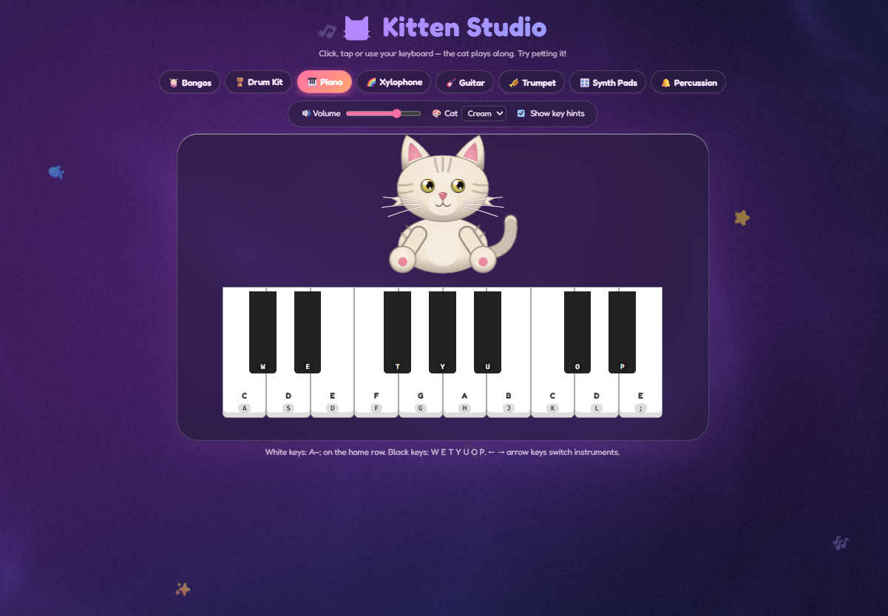

<div align="center">

🐟 ✨ 🎵 🐾 💖 ⭐ 🎶

# 🐱 Kitten Studio

[](Kitten_Studio.html)

**Play music with a kitten.** Click, tap or type — the cat plays along. Try petting it!

</div>

---

## About

**Kitten Studio** is a tiny, playful music toy that runs entirely in your browser. Pick one of eight instruments, hit the keys with your mouse, your finger or your keyboard, and an animated kitten bats at them with its paws in time with you.

There is **nothing to install**: the whole app is a single HTML file with no dependencies and no audio files. Every sound is synthesised live with the Web Audio API, and the cat, the keys and the dreamy background are all drawn in code.

- [Features](#features)
- [Quick start](#quick-start)
- [Controls](#controls)
- [Song examples](#song-examples)
- [Built with](#built-with)
- [Share your own songs](#share-your-own-songs)

## Features

- 🎹 **8 instruments**: Bongos, Drum Kit, Piano, Xylophone, Guitar, Trumpet, Synth Pads and Percussion.
- 🐱 **A kitten that reacts to you**: it blinks, twitches its ears, wags its tail, follows your cursor with its eyes and hits the keys you play with its left or right paw.
- 😸 **Combos**: play fast and the kitten gets happy (squinty eyes, speedy tail). Keep the streak going for a 🔥.
- 💖 **Pet the cat**: click or tap it for hearts and a meow. Leave it alone for a few seconds and it falls asleep (💤), then wakes up when you come back.
- 🎨 **Four coat colours**: Cream, Ginger, Gray and Black.
- 🌈 **Dreamy animated background**: a soft WebGL shader that glows toward your pointer and pulses with the music. It follows your light/dark mode.
- 🐾 **Cute cursors**: a paw for the pointer, a sparkly paw over things you can click, a squished paw when you press, and a heart over the cat.
- 📱 **Works with a mouse, touch or keyboard**: slide a finger or a held mouse button across the keys to glide over notes.
- ♿ **Respects reduced motion** and lets you hide the on-screen key hints.

## Quick start

**Run it locally:** download this repo and open `Kitten_Studio.html` in any modern browser. That's it.


## Controls

| Action | How |
| --- | --- |
| Play notes | Click / tap the keys, or press the matching keyboard key (shown on each key) |
| Switch instrument | Click a tab, or press <kbd>←</kbd> / <kbd>→</kbd> |
| Glide across keys | Hold the mouse button (or your finger) and slide over the keys |
| Pet the cat | Click or tap the kitten |
| Volume / cat colour / key hints | Use the bar above the stage |

### Keyboard map

| Instrument | Keys |
| --- | --- |
| 🥁 **Bongos** | <kbd>D</kbd> slap · <kbd>F</kbd> low · <kbd>J</kbd> high · <kbd>K</kbd> slap |
| 🪘 **Drum Kit** | <kbd>Q</kbd> crash · <kbd>W</kbd> tom 1 · <kbd>E</kbd> tom 2 · <kbd>R</kbd> ride · <kbd>A</kbd> hi-hat · <kbd>S</kbd> open hat · <kbd>D</kbd> snare · <kbd>F</kbd> floor tom · <kbd>Space</kbd> kick |
| 🎹 **Piano** | White keys <kbd>A</kbd> <kbd>S</kbd> <kbd>D</kbd> <kbd>F</kbd> <kbd>G</kbd> <kbd>H</kbd> <kbd>J</kbd> <kbd>K</kbd> <kbd>L</kbd> <kbd>;</kbd> = C D E F G A B C D E · Black keys <kbd>W</kbd> <kbd>E</kbd> <kbd>T</kbd> <kbd>Y</kbd> <kbd>U</kbd> <kbd>O</kbd> <kbd>P</kbd> |
| 🌈 **Xylophone** | <kbd>A</kbd>–<kbd>K</kbd> = a rising C major scale (C D E F G A B C) |
| 🎸 **Guitar** | Chords: <kbd>Z</kbd> Em · <kbd>X</kbd> Am · <kbd>C</kbd> C · <kbd>V</kbd> G · <kbd>B</kbd> D, then strings <kbd>1</kbd>–<kbd>6</kbd> or <kbd>Space</kbd> to strum |
| 🎺 **Trumpet** | <kbd>A</kbd>–<kbd>K</kbd> = C D E F G A B C |
| 🎛️ **Synth Pads** | <kbd>Q</kbd> C · <kbd>W</kbd> Dm · <kbd>E</kbd> Em · <kbd>R</kbd> F · <kbd>A</kbd> G · <kbd>S</kbd> Am · <kbd>D</kbd> Bdim · <kbd>F</kbd> C↑ |
| 🔔 **Percussion** | <kbd>A</kbd> cowbell · <kbd>S</kbd> tambourine · <kbd>D</kbd> clap · <kbd>F</kbd> triangle · <kbd>G</kbd> shaker · <kbd>H</kbd> wood block · <kbd>J</kbd> snap |

## Song examples

Pick an instrument, then press the keys in order. Each line is one phrase of the tune. The sequences only tell you *which* keys to press, so hum the song in your head to find the rhythm. `SP` means the <kbd>Space</kbd> bar.

All the songs below are traditional or public-domain tunes.

### 🎹 Piano

**Twinkle, Twinkle, Little Star** · *also works on Xylophone and Trumpet*
```
A A G G H H G
F F D D S S A
G G F F D D S
G G F F D D S
A A G G H H G
F F D D S S A
```

**Mary Had a Little Lamb** · *also works on Xylophone and Trumpet*
```
D S A S D D D
S S S
D G G
D S A S D D D D
S S D S A
```

**Hot Cross Buns** · *a great first song · also works on Xylophone and Trumpet*
```
D S A
D S A
A A A A S S S S
D S A
```

**Ode to Joy** (Ludwig van Beethoven) · *also works on Xylophone and Trumpet*
```
D D F G G F D S
A A S D D S S
D D F G G F D S
A A S D S A A
```

**Row, Row, Row Your Boat** · *also works on Xylophone and Trumpet*
```
A A A S D
D S D F G
K K K G G G D D D A A A
G F D S A
```

**Frère Jacques** · *also works on Xylophone and Trumpet*
```
A S D A
A S D A
D F G
D F G
G H G F D A
G H G F D A
K G K
K G K
```
*The last two lines jump up an octave so they fit on the keyboard.*

**Happy Birthday to You** · *Piano only (uses a black key)*
```
A A S A F D
A A S A G F
A A K H F D S
U U H F G F
```

**Für Elise** (Ludwig van Beethoven, opening) · *Piano only. Play the first two notes of each run quickly.*
```
; P ; P ; J L K H
A D H J
D Y J K
; P ; P ; J L K H
A D H J
D K J H
```

### 🎸 Guitar

Press a chord key (<kbd>Z</kbd> Em · <kbd>X</kbd> Am · <kbd>C</kbd> C · <kbd>V</kbd> G · <kbd>B</kbd> D), then strum with <kbd>Space</kbd>. Strum each chord four times before moving on.

**The "radio hit" loop** (G – D – Em – C)
```
V  SP SP SP SP
B  SP SP SP SP
Z  SP SP SP SP
C  SP SP SP SP
```

**The "sing it loud" loop** (Em – C – G – D)
```
Z  SP SP SP SP
C  SP SP SP SP
V  SP SP SP SP
B  SP SP SP SP
```

**Campfire** (G – C – G – D)
```
V  SP SP SP SP
C  SP SP SP SP
V  SP SP SP SP
B  SP SP SP SP
```

**Rolling arpeggio**: choose any chord, then pick the strings one at a time and repeat.
```
1 3 4 5 6 5 4 3
```

### 🎛️ Synth Pads

Press one pad at a time and let it ring.

```
The classic       Q S R A     (C  - Am - F  - G)
Sunrise           Q A S R     (C  - G  - Am - F)
Smooth landing    W A Q       (Dm - G  - C)
Dreamy            R Q A S     (F  - C  - G  - Am)
```

### 🥁 Drums & percussion

`SP` = <kbd>Space</kbd> (kick). Read each row left to right. A key sits under the beat it should be played on.

**Basic rock beat** (Drum Kit)
```
count    1    &    2    &    3    &    4    &
hi-hat   A    A    A    A    A    A    A    A
kick     SP                  SP
snare              D                   D
```

**Four on the floor** (Drum Kit)
```
count    1    &    2    &    3    &    4    &
kick     SP        SP        SP        SP
open hat      S         S         S         S
snare              D                   D
```

**Drum fill**: play it on the last bar of a pattern, then crash.
```
W E F F Q
```

**Easy groove** (Bongos): repeat it as long as you like.
```
F J J F J J F J
```

**Call and response** (Bongos)
```
F F J J
D K D K
```

**Shaker party** (Percussion)
```
count    1    &    2    &    3    &    4    &
shaker   G    G    G    G    G    G    G    G
cowbell  A                   A
clap               D                   D
wood blk                H                   H
```

## Built with

- **Vanilla HTML, CSS and JavaScript**: one file, no build step, no dependencies.
- **[Web Audio API](https://developer.mozilla.org/docs/Web/API/Web_Audio_API)**: every instrument is synthesised from oscillators and filtered noise, so there are no audio files to load.
- **Inline SVG**: the kitten, its paws and its expressions.
- **WebGL fragment shader**: the animated caustics and gradient background (it simply disappears if WebGL isn't available).
- **[Fredoka](https://fonts.google.com/specimen/Fredoka)** via Google Fonts for the rounded lettering. It's optional, and the app falls back to your system's rounded font.
